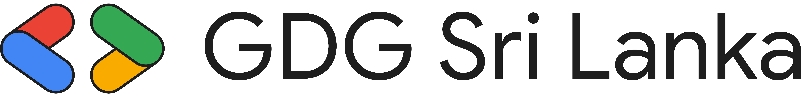
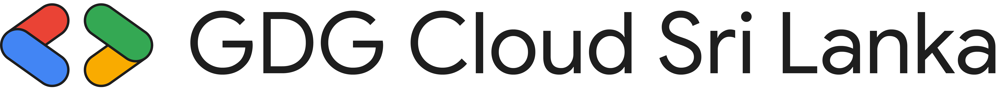
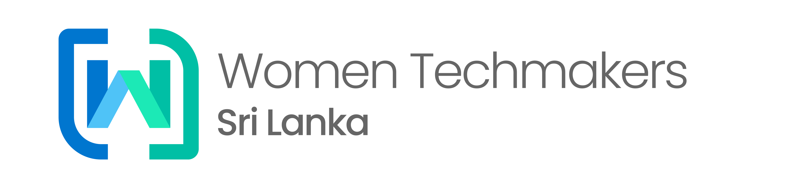
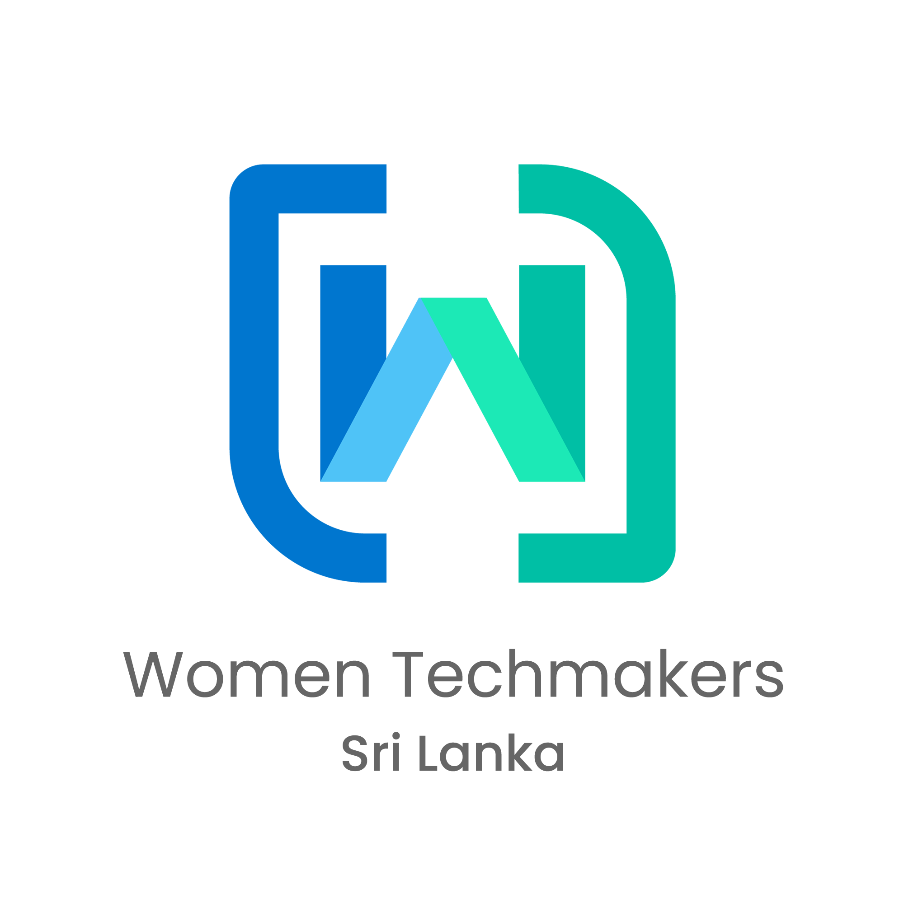
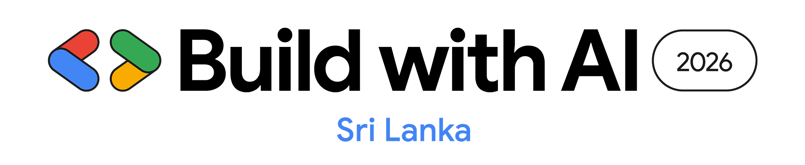
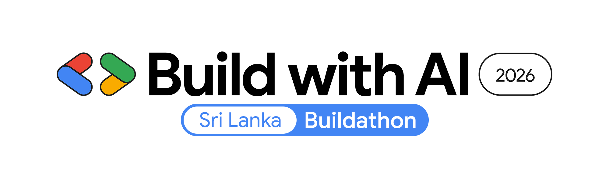

<picture>
  <source media="(prefers-color-scheme: dark)" srcset="logos/gdg-sri-lanka/gdg-sri-lanka-icon-white.png">
  
</picture>

# GDG Sri Lanka — Brand Assets

Official logos and brand assets for **Google Developer Groups Sri Lanka** and its
sister communities. Use them to represent our communities in event materials,
presentations, slides, social media, websites, and swag.

---

## 📦 What's inside

This repository is the single source of truth for the logos of the following communities:

| Community | Folder |
| --- | --- |
| GDG Sri Lanka | [`logos/gdg-sri-lanka`](logos/gdg-sri-lanka) |
| GDG Cloud Sri Lanka | [`logos/gdg-cloud-sri-lanka`](logos/gdg-cloud-sri-lanka) |
| Women Techmakers Sri Lanka | [`logos/women-techmakers-sri-lanka`](logos/women-techmakers-sri-lanka) |
| Build with AI Sri Lanka | [`logos/build-with-ai-sri-lanka`](logos/build-with-ai-sri-lanka) |
| Build with AI Buildathon | [`logos/buildathon-sri-lanka`](logos/buildathon-sri-lanka) |

Each logo is named with the pattern **`<community>-<layout>-<color>.png`**, where:

- **layout** — `horizontal` (landscape lockup), `stacked` (icon over text), or `icon` (mark only)
- **color** — `color` (for light backgrounds) or `white` (for dark backgrounds)

> **Tip:** Previews below automatically switch to the white variant when you view this
> page in GitHub's dark mode.

---

## 🎨 Logos

### GDG Sri Lanka

<table>
  <tr>
    <th align="left">Horizontal (color)</th>
    <th align="left">Icon (color / white)</th>
  </tr>
  <tr>
    <td valign="middle">
      
    </td>
    <td valign="middle">
      <picture>
        <source media="(prefers-color-scheme: dark)" srcset="logos/gdg-sri-lanka/gdg-sri-lanka-icon-white.png">
        
      </picture>
    </td>
  </tr>
</table>

### GDG Cloud Sri Lanka

<table>
  <tr>
    <th align="left">Horizontal (color)</th>
    <th align="left">Icon (color)</th>
  </tr>
  <tr>
    <td valign="middle">
      
    </td>
    <td valign="middle">
      
    </td>
  </tr>
</table>

### Women Techmakers Sri Lanka

<table>
  <tr>
    <th align="left">Horizontal</th>
    <th align="left">Stacked (color)</th>
  </tr>
  <tr>
    <td valign="middle">
      <picture>
        <source media="(prefers-color-scheme: dark)" srcset="logos/women-techmakers-sri-lanka/women-techmakers-sri-lanka-horizontal-white.png">
        
      </picture>
    </td>
    <td valign="middle">
      
    </td>
  </tr>
</table>

### Build with AI Sri Lanka

### Build with AI Buildathon

---

## ✅ Usage guidelines

- Use the **color** logos on light backgrounds and the **white** logos on dark backgrounds.
- Prefer the **horizontal** lockup for headers, banners, and wide spaces; use the **icon**
  for avatars, favicons, and tight square spaces.
- Keep clear space around the logo equal to at least the height of the logo mark, and
  never place it on a busy background that reduces legibility.
- **Don't** stretch, rotate, recolor, add effects to, or otherwise alter the logos.
- **Don't** use these marks to imply endorsement of a product, service, or event that is
  not organized by / in partnership with the respective community.

These logos incorporate Google's Google Developer Groups, Women Techmakers, and Build with
AI brand marks. When using them, please also follow Google's community brand guidelines and
trademark policy. See [`TRADEMARKS.md`](TRADEMARKS.md).

---

## 🎨 Brand colors

The Google core palette used across these marks:

| Color | Hex |
| --- | --- |
| Blue | `#4285F4` |
| Red | `#EA4335` |
| Yellow | `#FBBC04` |
| Green | `#34A853` |

Women Techmakers additionally uses its signature blue → teal gradient (`#1A73E8` → `#00A99D`).

---

## 🤝 Contributing

Found an outdated logo, or want to add assets for a new community, event, or format
(SVG, PDF)? See [`CONTRIBUTING.md`](CONTRIBUTING.md) and open a pull request.

## 📄 License

The assets in this repository are trademarks of Google and/or the respective communities.
See [`TRADEMARKS.md`](TRADEMARKS.md) for usage terms.
