

<picture>
  <source media="(prefers-color-scheme: dark)" srcset="logos/gdg-sri-lanka/gdg-sri-lanka-icon-color.png">
  
</picture>

# GDG Sri Lanka — Brand Assets

Official logos and brand assets for **Google Developer Groups Sri Lanka** and its
sister communities. Use them to represent our communities in event materials,
presentations, slides, social media, websites, and swag.

---

## 📦 What's inside

This repository is the single source of truth for the logos of the following communities:

| Community | Folder |
| --- | --- |
| GDG Sri Lanka | [`logos/gdg-sri-lanka`](logos/gdg-sri-lanka) |
| GDG Cloud Sri Lanka | [`logos/gdg-cloud-sri-lanka`](logos/gdg-cloud-sri-lanka) |
| Women Techmakers Sri Lanka | [`logos/women-techmakers-sri-lanka`](logos/women-techmakers-sri-lanka) |
| Build with AI Sri Lanka | [`logos/build-with-ai-sri-lanka`](logos/build-with-ai-sri-lanka) |
| Build with AI Buildathon | [`logos/buildathon-sri-lanka`](logos/buildathon-sri-lanka) |
| DevFest Sri Lanka 2026 | [`logos/devfest-sri-lanka`](logos/devfest-sri-lanka) |

It also holds event artwork:

| Assets | Folder |
| --- | --- |
| DevFest Sri Lanka 2026 banners & covers | [`banners/devfest-sri-lanka-2026`](banners/devfest-sri-lanka-2026) |
| DevFest 2026 graphic elements | [`elements/devfest-2026`](elements/devfest-2026) |

Each logo is named with the pattern **`<community>-<layout>-<color>.png`**, where:

- **layout** — `horizontal` (landscape lockup), `stacked` (icon over text), or `icon` (mark only)
- **color** — `color` (for light backgrounds) or `white` (for dark backgrounds)

> **Tip:** Every logo below is shown on both a light and a dark background, with its file
> name underneath. Download the files from each logo folder; the preview cards themselves
> live in [`docs/previews`](docs/previews).

---

## 🎨 Logos

### GDG Sri Lanka

<table>
  <tr>
    <th align="left">Light backgrounds</th>
    <th align="left">Dark backgrounds</th>
  </tr>
  <tr>
    <td valign="middle">
      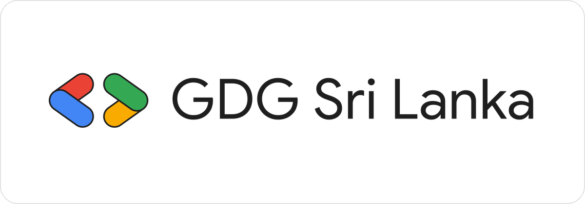 
      <code>gdg-sri-lanka-horizontal-color.png</code>
    </td>
    <td valign="middle">
      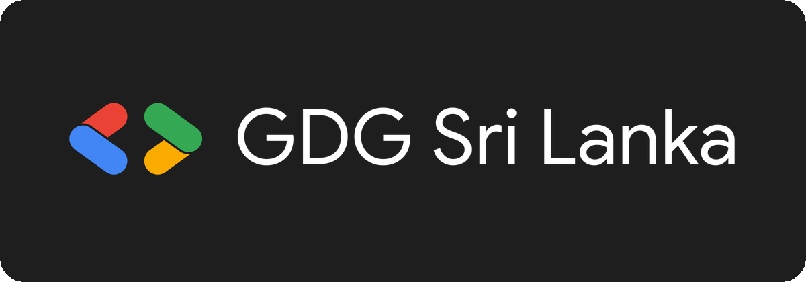 
      <code>gdg-sri-lanka-icon-color.png</code>
    </td>
  </tr>
  <tr>
    <td valign="middle">
      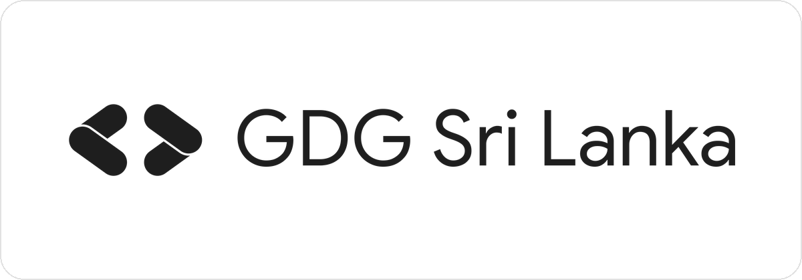 
      <code>gdg-sri-lanka-horizontal-black.png</code>
    </td>
    <td valign="middle">
      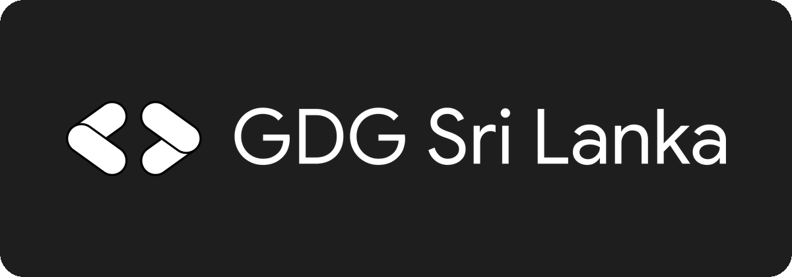 
      <code>gdg-sri-lanka-icon-white.png</code>
    </td>
  </tr>
</table>

> **Note:** despite their names, the `icon` files hold the full horizontal lockup for dark
> backgrounds (color mark with white text, and all white). The second row is the
> single-color (monochrome) version. There is no mark-only icon yet.

### GDG Cloud Sri Lanka

<table>
  <tr>
    <th align="left">Light backgrounds</th>
    <th align="left">Dark backgrounds</th>
  </tr>
  <tr>
    <td valign="middle">
      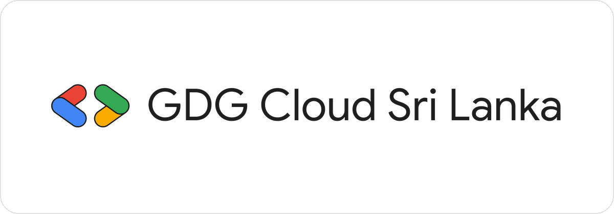 
      <code>gdg-cloud-sri-lanka-horizontal-color.png</code>
    </td>
    <td valign="middle">
      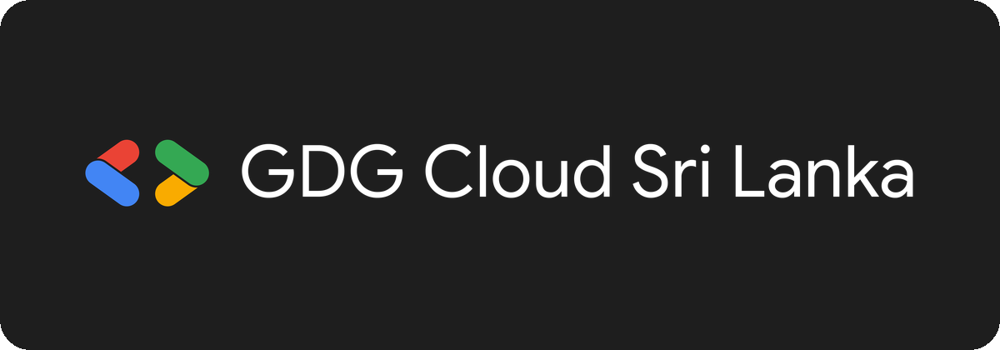 
      <code>gdg-cloud-sri-lanka-icon-color.png</code>
    </td>
  </tr>
</table>

> **Note:** despite its name, `gdg-cloud-sri-lanka-icon-color.png` is the full horizontal
> lockup for dark backgrounds (color mark with white text).

### Women Techmakers Sri Lanka

<table>
  <tr>
    <th align="left">Light backgrounds</th>
    <th align="left">Dark backgrounds</th>
  </tr>
  <tr>
    <td valign="middle">
      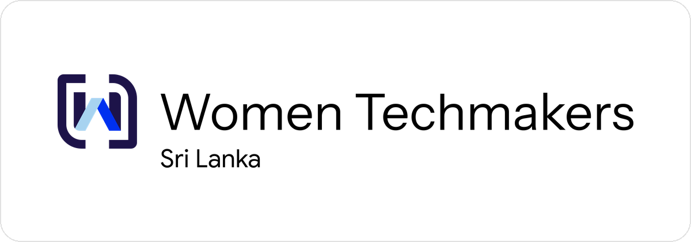 
      <code>women-techmakers-sri-lanka-horizontal-color.png</code>
    </td>
    <td valign="middle">
      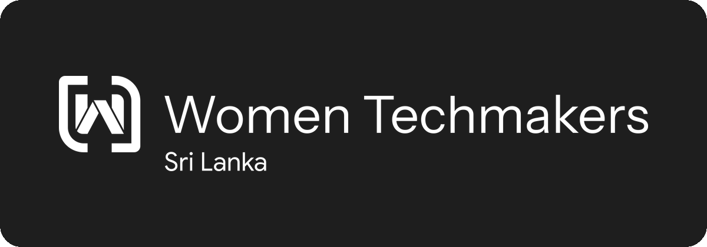 
      <code>women-techmakers-sri-lanka-horizontal-white.png</code>
    </td>
  </tr>
</table>

The new Women Techmakers one-line logo. See the
[folder README](logos/women-techmakers-sri-lanka) for all files.

### Build with AI Sri Lanka

<table>
  <tr>
    <th align="left">Light backgrounds</th>
    <th align="left">Dark backgrounds</th>
  </tr>
  <tr>
    <td valign="middle">
      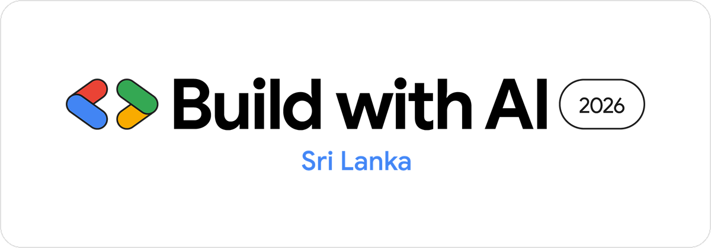 
      <code>build-with-ai-sri-lanka-horizontal-color.png</code>
    </td>
    <td valign="middle">
      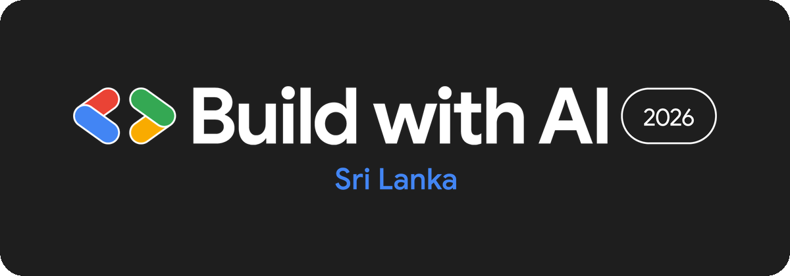 
      <code>build-with-ai-sri-lanka-horizontal-white.png</code>
    </td>
  </tr>
</table>

### Build with AI Buildathon

<table>
  <tr>
    <th align="left">Light backgrounds</th>
    <th align="left">Dark backgrounds</th>
  </tr>
  <tr>
    <td valign="middle">
      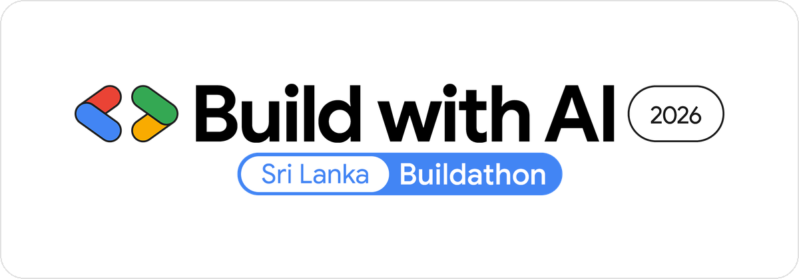 
      <code>buildathon-sri-lanka-horizontal-color.png</code>
    </td>
    <td valign="middle">
       
      <code>buildathon-sri-lanka-horizontal-white.png</code>
    </td>
  </tr>
</table>

### DevFest Sri Lanka 2026

<table>
  <tr>
    <th align="left">Light backgrounds</th>
    <th align="left">Dark backgrounds</th>
  </tr>
  <tr>
    <td valign="middle">
      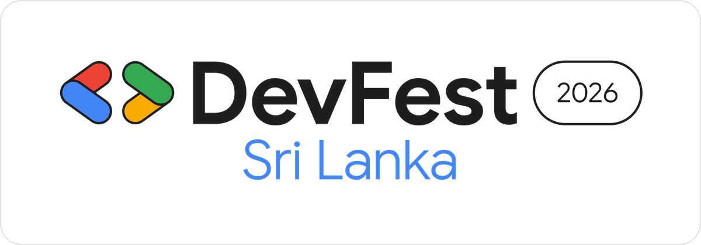 
      <code>devfest-sri-lanka-horizontal-color.png</code>
    </td>
    <td valign="middle">
      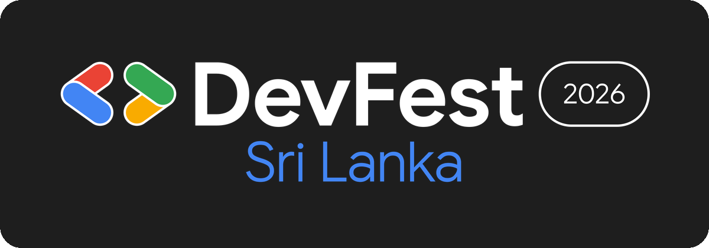 
      <code>devfest-sri-lanka-horizontal-white.png</code>
    </td>
  </tr>
  <tr>
    <td valign="middle">
      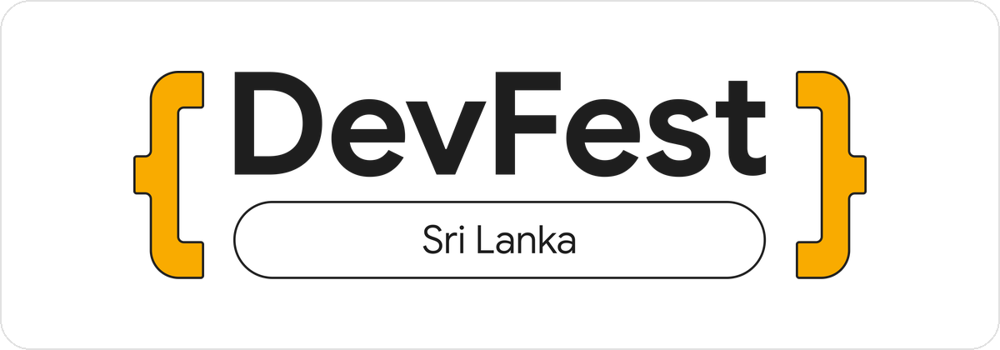 
      <code>devfest-sri-lanka-stacked-color.png</code>
    </td>
    <td valign="middle">
      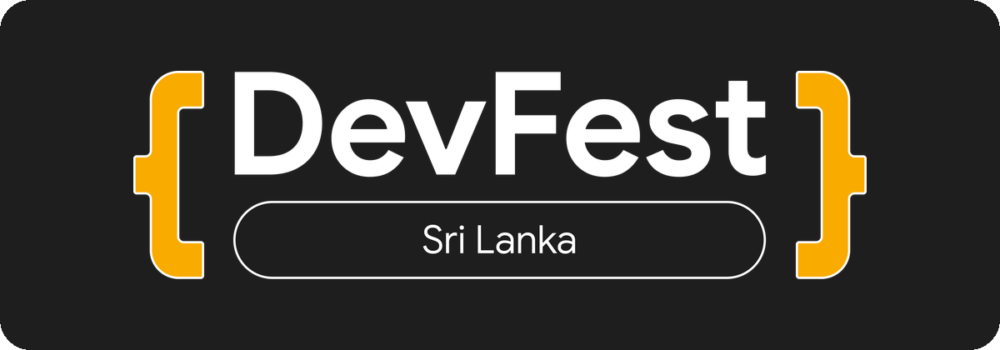 
      <code>devfest-sri-lanka-stacked-white.png</code>
    </td>
  </tr>
</table>

Also available as SVG.

---

## 🖼️ Banners

Ready-to-upload DevFest Sri Lanka 2026 banners and covers — GDG community platform banner
and thumbnail, website header, Google Form header, LinkedIn cover, and X header — in
[`banners/devfest-sri-lanka-2026`](banners/devfest-sri-lanka-2026).

---

## ✳️ Graphic elements

The DevFest 2026 code-symbol shapes (filled and line styles) plus the GDG color stripe, as
SVG and PNG, in [`elements/devfest-2026`](elements/devfest-2026).

  
  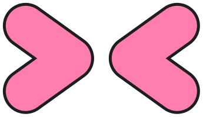
  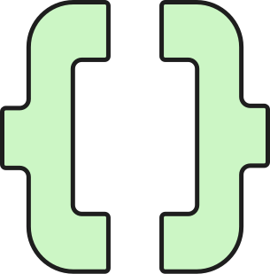
  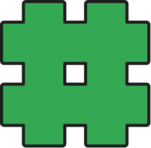
  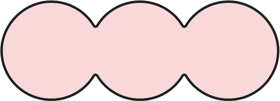
  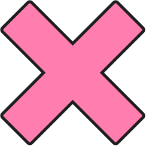
  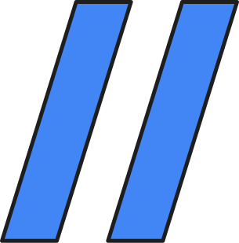

---

## ✅ Usage guidelines

- Use the **color** logos on light backgrounds and the **white** logos on dark backgrounds.
- Prefer the **horizontal** lockup for headers, banners, and wide spaces; use the **icon**
  for avatars, favicons, and tight square spaces.
- Keep clear space around the logo equal to at least the height of the logo mark, and
  never place it on a busy background that reduces legibility.
- **Don't** stretch, rotate, recolor, add effects to, or otherwise alter the logos.
- **Don't** use these marks to imply endorsement of a product, service, or event that is
  not organized by / in partnership with the respective community.

These logos incorporate Google's Google Developer Groups, Women Techmakers, Build with AI,
and DevFest brand marks. When using them, please also follow Google's community brand guidelines and
trademark policy. See [`TRADEMARKS.md`](TRADEMARKS.md).

---

## 🎨 Brand colors

The Google core palette used across these marks:

| Color | Hex |
| --- | --- |
| Blue | `#4285F4` |
| Red | `#EA4335` |
| Yellow | `#FBBC04` |
| Green | `#34A853` |

The Women Techmakers logo uses its own palette: navy `#1D1349`, blue `#0030EF`, and light
blue `#A7D3F0`, with black text (white on dark backgrounds).

---

## 🤝 Contributing

Found an outdated logo, or want to add assets for a new community, event, or format
(SVG, PDF)? See [`CONTRIBUTING.md`](CONTRIBUTING.md) and open a pull request.

## 📄 License

The assets in this repository are trademarks of Google and/or the respective communities.
See [`TRADEMARKS.md`](TRADEMARKS.md) for usage terms.
