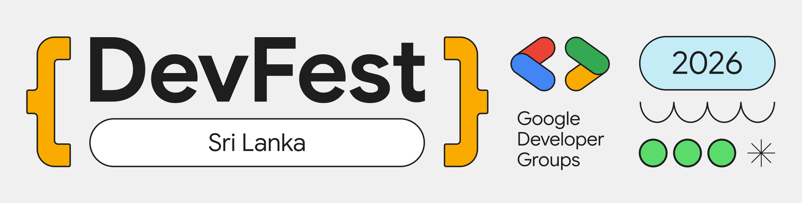
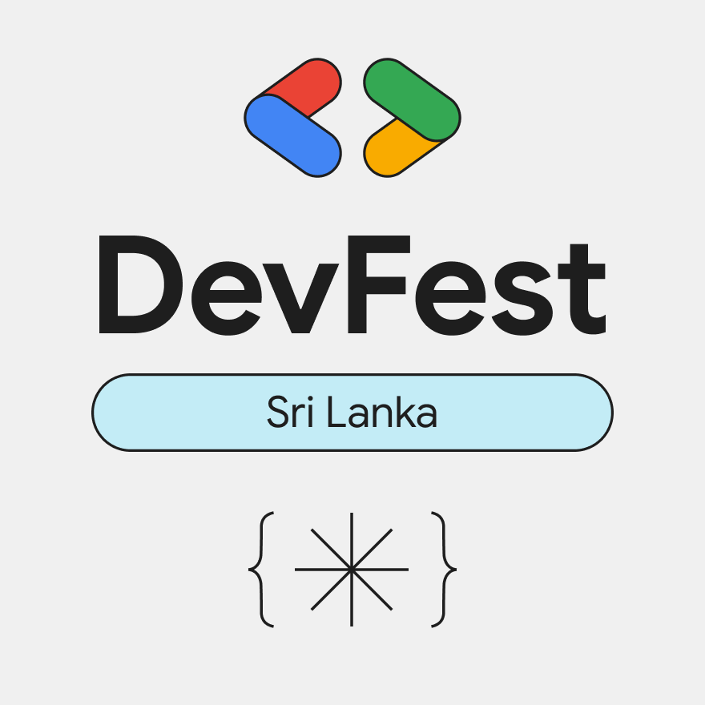

# DevFest Sri Lanka 2026 — Banners

Ready-to-upload banners and covers for **DevFest Sri Lanka 2026**, exported at each
platform's full size.

| File | Size (px) | Use it for |
| --- | --- | --- |
| `devfest-sri-lanka-2026-gdg-event-platform-banner-2560x650.png` | 2560 × 650 | GDG community platform event banner |
| `devfest-sri-lanka-2026-event-thumbnail-880x880.png` | 880 × 880 | GDG community platform event thumbnail |
| `devfest-sri-lanka-2026-web-header-1440x500.png` | 1440 × 500 | Website / landing page header |
| `devfest-sri-lanka-2026-google-form-header-1600x400.png` | 1600 × 400 | Google Forms header image |
| `devfest-sri-lanka-2026-linkedin-cover-2256x382.png` | 2256 × 382 | LinkedIn page cover |
| `devfest-sri-lanka-2026-x-header-1500x500.png` | 1500 × 500 | X (Twitter) header |

Upload the files as they are — don't crop, stretch, or recolor them.

See the [root README](../../README.md) for usage guidelines and trademark terms.
