# DevFest 2026 — Graphic elements

The code-symbol shapes from the official DevFest 2026 brand kit, for decorating posts,
slides, banners, stickers, and swag. Every element comes as an **SVG** (vector) and a
transparent **PNG** at 4× its SVG size.

```
elements/devfest-2026/
├── filled/   devfest-2026-filled-<name>.svg / .png   (color fill + dark outline)
├── line/     devfest-2026-line-<name>.svg / .png     (thin dark outline only)
└── devfest-2026-gdg-color-stripe.svg / .png          (blue · red · yellow · green bar)
```

## Filled

<p>
  
  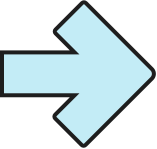
  
  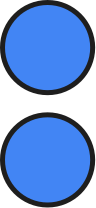
  
  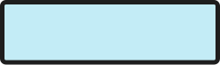
  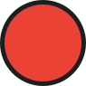
  
  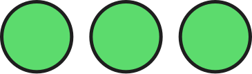
  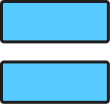
  
  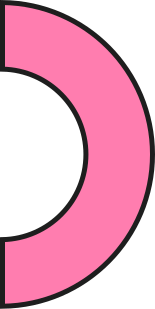
  
  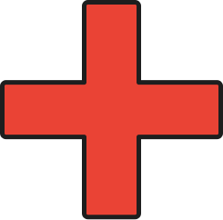
  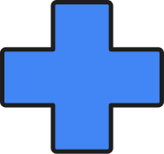
  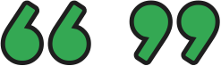
  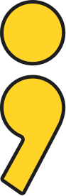
  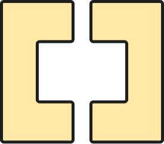
  
  
</p>

`arrow` · `arrow-short` · `chevrons` · `colon` · `curly-braces` · `dash` · `dot` ·
`double-slash` · `ellipsis` · `equals` · `half-circle-left` · `half-circle-right` · `hash` ·
`plus` · `plus-rounded` · `quotes` · `semicolon` · `square-brackets` · `triple-circle` · `x`

## Line

<p>
  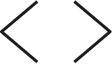
  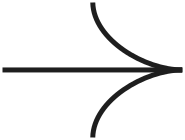
  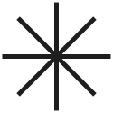
  
  
  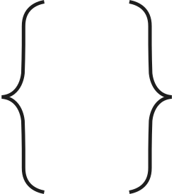
  
  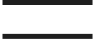
  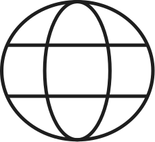
  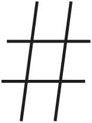
  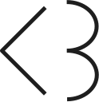
  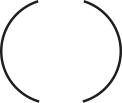
  
  
  
  
  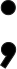
  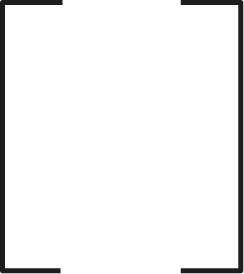
</p>

`angle-brackets` · `arrow` · `asterisk` · `at` · `colon` · `curly-braces` · `double-slash` ·
`equals` · `globe` · `hash` · `heart` (`<3`) · `parentheses` · `scallop-3-left` ·
`scallop-3-right` · `scallop-4-left` · `scallop-4-right` · `semicolon` · `square-brackets`

> The line elements are drawn in dark ink, so they are hard to see in GitHub's dark mode.

## GDG color stripe

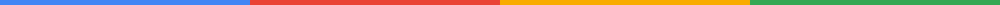

A full-width bar in the four Google colors for the top and bottom edges of posts and slides.

## Using the elements

- Scale them freely, and keep the proportions (don't stretch).
- Use them as accents around content — not behind text where they hurt legibility.
- The filled elements use the DevFest 2026 palette, whose yellow is `#F9AB00`.

See the [root README](../../README.md) for usage guidelines and trademark terms.
