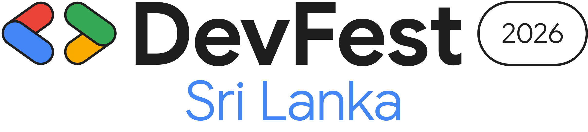

# DevFest Sri Lanka

Logos for **DevFest Sri Lanka 2026**, built from the official DevFest 2026 brand kit.

| File | Layout | Color | Best for |
| --- | --- | --- | --- |
| `devfest-sri-lanka-horizontal-color.png` / `.svg` | Horizontal | Color | Headers, posts, slides, light backgrounds |
| `devfest-sri-lanka-horizontal-white.png` / `.svg` | Horizontal | White | Headers, posts, slides, dark backgrounds |
| `devfest-sri-lanka-stacked-color.png` / `.svg` | Stacked | Color | Banners, stickers, compact spaces, light backgrounds |
| `devfest-sri-lanka-stacked-white.png` / `.svg` | Stacked | White | Banners, stickers, compact spaces, dark backgrounds |

- **Horizontal** — the DevFest 2026 primary lockup (GDG mark + DevFest + 2026) with "Sri Lanka" below.
- **Stacked** — the DevFest 2026 editable-location lockup: DevFest over a "Sri Lanka" pill, between the yellow braces.

The **white** versions keep the colored GDG mark, braces, and blue "Sri Lanka"; only the
black parts switch to white. PNGs have transparent backgrounds (horizontal 2415 px wide,
stacked 2951 px wide). SVGs are fully vector, with text converted to outlines.

<picture>
  <source media="(prefers-color-scheme: dark)" srcset="devfest-sri-lanka-horizontal-white.png">
  
</picture>

<picture>
  <source media="(prefers-color-scheme: dark)" srcset="devfest-sri-lanka-stacked-white.png">
  
</picture>

See the [root README](../../README.md) for usage guidelines and trademark terms.
